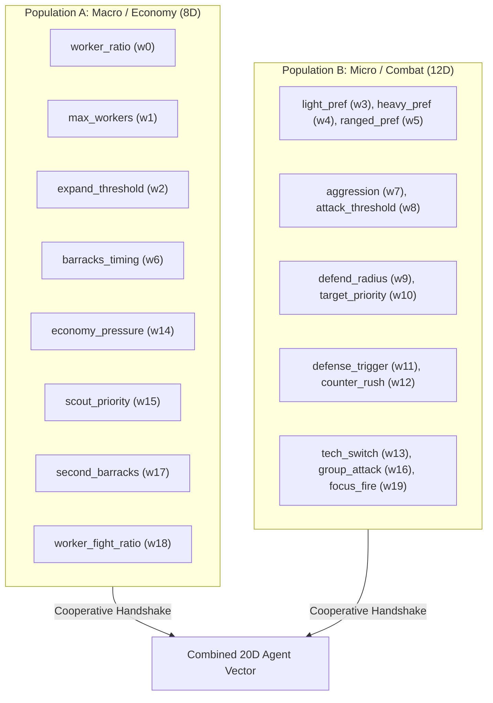
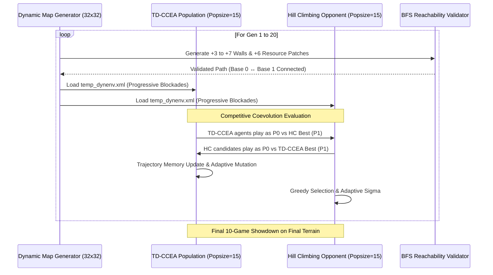

# Technical & Mathematical Specification: Trajectory-Directed Cooperative Co-Evolutionary Algorithm (TD-CCEA)

This document provides the complete formal specification of **Our Algorithm (TD-CCEA / CCE-TDCCEA)** and its extension to **Competitive Coevolution in Dynamic Environments (Progressive Blockades & Shifting Economics)** as implemented in our microRTS framework.

---

## 1. Architectural Overview & Search Space Decomposition

In microRTS, an agent's strategic behavior is parameterized by a continuous vector $\mathbf{w} \in [0, 1]^D$ of $D = 20$ behavioral weights controlling economy, production timing, tactical combat, and aggression.

### 1.1 Why Cooperative Co-Evolution?
Searching a $20$-dimensional continuous landscape monolithic-style suffers from the **curse of dimensionality** and the **"tragic flaw" problem** (a brilliant economic strategy is discarded if generated alongside a poor tactical combat weight).

To overcome this, **CCE-TDCCEA** decomposes the strategy space into two specialized sub-populations:

- **Exponential Speedup**: Mathematically, searching two decoupled subspaces of dimensions $D_A = 8$ and $D_B = 12$ converges exponentially faster than searching a single $20\text{D}$ space ($O(c^{8} + c^{12}) \ll O(c^{20})$).
- **The Cooperative Handshake**: To evaluate an individual $\mathbf{x} \in \text{Pop}_A$, it is paired with elite partners $\mathbf{y} \in \text{Pop}_B$ to form a valid $20\text{D}$ weight vector $\mathbf{w} = \mathbf{x} \oplus \mathbf{y}$.

---

## 2. Mathematical Formulation of TD-CCEA Mechanics

Standard evolutionary algorithms suffer from **cyclic forgetting** and genetic drift in non-stationary or coevolutionary environments. TD-CCEA introduces **trajectory-directed memory** and **adaptive mutation** to stabilize convergence.

### 2.1 Trajectory Memory ($H_i$)
Each agent $i$ maintains a sliding historical memory of its evaluations over the last $W$ generations ($W = 5$ or $7$):

$$H_i = \Big\{ (f_t, \mathbf{e}_t) \Big\}_{t=1}^{|H_i|}$$

where:
- $f_t \in [0, 1]$ is the empirical game win rate / fitness achieved at historical generation $t$.
- $\mathbf{e}_t \in [0, 1]^D$ is the **environmental centroid** (the mean parameter vector of the opposing/partner population at generation $t$).

### 2.2 Trajectory-Directed Fitness Formulation ($e_i$)
Instead of relying solely on the instantaneous fitness (which can be noisy in dynamic games), an agent's effective trajectory fitness $e_i$ weights past evaluations by how **environmentally similar** that historical state was to the current environment $\mathbf{e}_{\text{curr}}$:

$$e_i = \sum_{t=1}^{|H_i|} \tilde{w}_t \cdot f_t$$

where the normalized trajectory weight $\tilde{w}_t$ is computed via Euclidean similarity:

$$w_t = \max\left( 0.01,\; 1 - \frac{\|\mathbf{e}_t - \mathbf{e}_{\text{curr}}\|_2}{\sqrt{D}} \right), \quad \tilde{w}_t = \frac{w_t}{\sum_{k=1}^{|H_i|} w_k}$$

> [!NOTE]
> **Why this matters**: If the environment or opponent shifts back to a strategy seen 3 generations ago, TD-CCEA automatically upweights historical performance in that specific regime, preventing the algorithm from discarding robust generalist traits.

---

### 2.3 Adaptive Mutation Step-Size ($\mu_i$)
Each agent dynamically adjusts its Gaussian mutation step-size $\mu_i$ based on its trajectory fitness $e_i$:

$$\mu_i = \mu_{\text{base}} \cdot (1 - e_i) + \mu_{\text{min}}$$

where $\mu_{\text{base}} = 0.15$ and $\mu_{\text{min}} = 0.03$.
- **High-Performing Agents ($e_i \to 1$)**: $\mu_i \to 0.03$ (fine-grained exploitation and local polishing).
- **Struggling Agents ($e_i \to 0$)**: $\mu_i \to 0.18$ (broad exploration to escape poor local optima).

---

### 2.4 Diversity-Preserving Survival & Elite Archive
To prevent premature convergence to a single tactical exploit:
1. **Euclidean Diversity Threshold ($\Delta_S = 0.85$)**: Survivors are added greedily by fitness only if their Euclidean distance from all currently accepted survivors exceeds $\Delta_S \cdot \sqrt{D}$.
2. **Fitness Pruning ($\Delta_F = 0.20$)**: Agents persistently scoring below $\Delta_F$ over $\ge 3$ generations are culled.
3. **Elite Archive ($A_{\text{max}} = 10 \text{ to } 15$)**: The top 3 individuals of each generation are copied into a historical archive. Breeding draws parents from both the surviving population and this archive, ensuring that foundational strategies are never permanently lost.

---

## 3. Competitive Coevolution in Dynamic Environments (`tdccea_dynamic_env.py`)

In our latest extension, we subject TD-CCEA to a **Competitive Arms Race** inside a **Continuously Shifting Physical & Economic Environment**.

### 3.1 Progressive Blockade Generation
In generation $g$, new obstacles are injected into the $32\times32$ arena:
- **Early ($g \le 7$)**: $+3$ walls / gen.
- **Mid ($8 \le g \le 14$)**: $+5$ walls / gen.
- **Late ($g \ge 15$)**: $+7$ walls / gen.
- **Wall Types**:
  - **$60\%$ Unbreakable Terrain Walls** ($\text{TERRAIN\_WALL} = 1$ in PhysicalGameState XML).
  - **$40\%$ Destructible Obstacles** ($\text{Wall}$ neutral units with $\text{HP}=5$, requiring agents to decide whether to attack through or path around).

### 3.2 Dynamic Shifting Economics (Random Resource Patches)
Each generation generates **6 randomized resource patches** ($10$ resources per patch) scattered across the map (excluding reserved base/worker buffer zones). This forces agents to continuously adapt their `expand_threshold` ($w_2$), `scout_priority` ($w_{15}$), and `worker_ratio` ($w_0$) rather than memorizing fixed harvest lines.

### 3.3 BFS Reachability Guarantee
To ensure the generated terrain never creates a soft-locked or illegal game state, every candidate wall position $(x, y)$ is verified via **Breadth-First Search (BFS)** before placement:

$$\text{BFS\_Reachable}(\mathcal{W}_{\text{all}} \cup \{(x, y)\}, \; \text{Base}_0, \; \text{Base}_1) = \text{True}$$

If placing a wall breaks connectivity between the two player bases, the coordinates are rejected and resampled.

---

## 4. Why TD-CCEA Outperforms Hill Climbing in Dynamic Environments

| Metric / Capability | Hill Climbing (Greedy Local Search) | Our Algorithm (TD-CCEA) |
| :--- | :--- | :--- |
| **Memory / Historical Context** | **None** (Only tracks current single best candidate $\mathbf{x}_{\text{curr}}$). | **Trajectory Memory ($H_i$)** tracks historical fitness and environmental centroids. |
| **Response to Map Changes** | Often **forgets** previously learned pathing/economy weights when adapting to a new blockade. | **Trajectory Fitness ($e_i$)** smooths evaluations, preserving robust generalist traits across map shifts. |
| **Exploration Regulation** | Uses simple global Gaussian mutation ($\sigma$). | **Adaptive Step-Size ($\mu_i$)** automatically scales per-agent exploration based on trajectory fitness. |
| **Population Diversity** | None (single-point trajectory or simple mutant cloud). | **Euclidean Diversity Filtering ($\Delta_S$)** maintains a structurally diverse set of survivors. |
| **Search Space Efficiency** | Searches full $20\text{D}$ space monolithically. | **Cooperative Decomposition (8D + 12D)** converges exponentially faster in multi-objective RTS landscapes. |

---

## 5. Verification Checklist for Your Presentation / Report

When checking and defending this algorithm in academic reviews, ensure these 4 pillars are emphasized:
1. **Mathematical Soundness**: Explicitly cite the Trajectory Fitness formula ($e_i$) and show how Euclidean similarity weights historical evaluations.
2. **Cooperative Decomposition**: Show the clean 8-Macro / 12-Micro weight breakdown from `WEIGHT_NAMES`.
3. **Competitive Coevolution**: Explain that in `tdccea_dynamic_env.py`, TD-CCEA and Hill Climbing evolve **directly against each other's elite bots** (an arms race) while the physical terrain and resources shift simultaneously.
4. **Validation Integrity**: Point out the automated **BFS reachability checks** and multi-core parallel evaluation (`ThreadPoolExecutor` managing 15 parallel Java servers).
